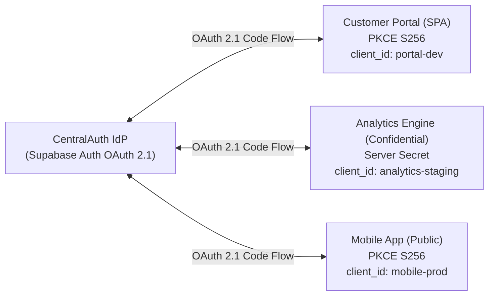

# CentralAuth — Central OAuth 2.1 Identity Provider

**CentralAuth** is an enterprise-grade, centralized OAuth 2.1 and OpenID Connect Identity Provider (IdP) built on top of Supabase Auth. It enables unified single sign-on, centralized user management, and zero-trust application isolation across multiple independent web, mobile, and backend services.

---

## Architecture at a Glance



- **Centralized Identity**: One authoritative user database in Supabase Auth. Passwords and credentials are never duplicated.
- **OAuth 2.1 & PKCE S256**: Enforces Authorization Code Flow with PKCE for all public clients (SPAs, Mobile). Deprecated implicit and password grants are fully prohibited.
- **Asymmetric JWT Verification**: Tokens signed via RS256/ES256 and validated by consuming resource servers using standard public JWKS (`/.well-known/jwks.json`).
- **Strict Client Isolation**: Every application has its own client registration, redirect URIs, and scopes. Application A tokens cannot access Application B resources.
- **Dedicated Consent Screen**: Hosted at `/oauth/consent`, integrating natively with `supabase.auth.oauth.getAuthorizationDetails()`, `approveAuthorization()`, and `denyAuthorization()`.

---

## Project Structure

```
centralauth/
├── docs/                                  # Complete Architectural & Operational Documentation
│   ├── ARCHITECTURE.md                    # System architecture and trust boundaries
│   ├── SUPABASE_SETUP.md                  # Complete Supabase dashboard setup guide
│   ├── OAUTH_INTEGRATION.md               # Consuming-application integration guide (SPA & Backend)
│   ├── SECURITY.md                        # Threat model, cryptographic standards, and RLS
│   ├── APP_ONBOARDING.md                  # 11-step application registration procedure
│   └── TROUBLESHOOTING.md                 # Diagnostic flowchart and common error fixes
├── src/
│   ├── app/                               # Next.js App Router (Production Web App)
│   │   ├── account/                       # User profile, active consents, security settings
│   │   ├── admin/                         # Administrative interface
│   │   │   ├── apps/                      # OAuth Application Registry (catalog & metadata)
│   │   │   ├── users/                     # Central user management & search
│   │   │   └── audit/                     # Immutable administrative audit log viewer
│   │   ├── api/                           # Server-side API Route Handlers
│   │   │   ├── admin/apps/                # App registry CRUD & audit logging
│   │   │   ├── admin/users/               # User management via service role
│   │   │   ├── auth/callback/             # PKCE code exchange callback handler
│   │   │   └── oauth/validate-token/      # Token verification endpoint for resource servers
│   │   ├── forgot-password/               # Password recovery request
│   │   ├── login/                         # Central sign-in (Password, Magic Link, OAuth return)
│   │   ├── oauth/
│   │   │   ├── consent/                   # OAuth 2.1 Consent Screen (/oauth/consent)
│   │   │   └── error/                     # OAuth error handling page
│   │   ├── register/                      # Central registration & email verification
│   │   ├── reset-password/                # Secure password update handler
│   │   ├── globals.css                    # Tailwind CSS styling
│   │   ├── layout.tsx                     # Global layout and navigation header
│   │   └── page.tsx                       # CentralAuth Portal overview & health status
│   ├── components/
│   │   └── Navbar.tsx                     # Navigation bar with live authentication state
│   └── lib/
│       ├── oauth/
│       │   ├── scopes.ts                  # Supported OAuth 2.1 & OIDC scope definitions
│       │   └── validator.ts               # PKCE S256, URI matching, JWT & client isolation validators
│       ├── supabase/
│       │   ├── admin.ts                   # Privileged server-side service-role client (SERVER ONLY)
│       │   ├── client.ts                  # Browser-side public Supabase client
│       │   └── server.ts                  # Cookie-based server-side Supabase client
│       └── types/
│           └── auth.ts                    # Core TypeScript interfaces & types
├── supabase/
│   └── migrations/
│       └── 20260101000000_central_auth_schema.sql # PostgreSQL schema, RLS, & Custom Access Token Hook
├── tests/
│   └── oauth_and_security.test.ts         # Automated Vitest test suite (18 security scenarios)
├── .env.example                           # Documented safe configuration template
├── package.json                           # Dependencies and test/build scripts
├── tailwind.config.ts                     # Tailwind CSS styling configuration
├── tsconfig.json                          # Strict TypeScript configuration
└── vitest.config.ts                       # Vitest test runner configuration
```

---

## Getting Started

### 1. Prerequisites
- Node.js >= 18.0.0
- A Supabase Project configured according to [`docs/SUPABASE_SETUP.md`](docs/SUPABASE_SETUP.md)

### 2. Configure Environment Variables
Copy `.env.example` to `.env.local`:
```bash
cp .env.example .env.local
```
Fill in your Supabase project parameters:
```env
NEXT_PUBLIC_SUPABASE_URL=https://<your-project-ref>.supabase.co
NEXT_PUBLIC_SUPABASE_ANON_KEY=<your-anon-key>
SUPABASE_SERVICE_ROLE_KEY=<your-service-role-key> # Server-side only
NEXT_PUBLIC_APP_URL=http://localhost:3000
```

### 3. Apply PostgreSQL Migrations
In your Supabase Dashboard SQL Editor, run the contents of:
`supabase/migrations/20260101000000_central_auth_schema.sql`

This provisions:
- `oauth_app_registry`: Internal application catalog tracking client metadata and environment tier.
- `oauth_user_consents`: User grant records with scope history.
- `application_roles` & `user_application_roles`: Client-isolated role-based access control.
- `audit_logs`: Administrative actions tracking.
- Row Level Security (RLS) policies protecting all tables.
- `custom_access_token_hook`: PL/pgSQL hook injecting application roles into JWTs based on `client_id`.

### 4. Run Development Server
```bash
npm run dev
```
Open [http://localhost:3000](http://localhost:3000) in your browser.

---

## Running Automated Tests

The automated test suite runs 16 comprehensive security and protocol tests with in-memory RS256 cryptographic verification:

```bash
npm test
```

Verification covers:
- Credential validation and short-password rejection
- Email verification state checks
- Approved and denied authorization handling (`access_denied`)
- Missing and malformed `authorization_id` detection
- Strict exact redirect URI matching (wildcard and fragment prohibition)
- S256 PKCE code challenge and verifier verification (RFC 7636)
- CSRF state parameter timing-safe validation
- Expired JWT token rejection
- Active token and refresh token structure validation
- RS256 signature tampering, wrong issuer, and wrong audience rejection
- Zero-trust client isolation (App A token rejected by App B)
- Secret exposure checks (verifying confidential secrets are not exposed to browsers)
- Application-level role and permission enforcement
- Environment configuration isolation (Dev vs Staging vs Prod)
- User session revocation

---

## Build for Production

```bash
npm run build
npm run start
```

---

## Documentation Links

- [System Architecture & Trust Boundaries](docs/ARCHITECTURE.md)
- [Complete Supabase Dashboard Setup Guide](docs/SUPABASE_SETUP.md)
- [Consuming Application Integration Guide](docs/OAUTH_INTEGRATION.md)
- [Security Controls & Threat Model](docs/SECURITY.md)
- [Application Onboarding Procedure](docs/APP_ONBOARDING.md)
- [Troubleshooting & Error Resolutions](docs/TROUBLESHOOTING.md)
