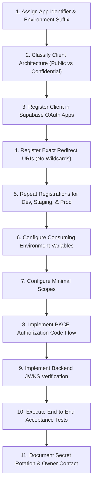

# New Application Onboarding Procedure

This runbook defines the repeatable, audited 11-step process for onboarding any new application to **CentralAuth**.

---

## 1. Onboarding Checklist



---

## 2. Step-by-Step Instructions

### Step 1: Assign Unique Client Identifiers
Follow the enterprise naming convention: `<service-name>-<client-type>-<environment>`

- **Examples**:
  - `billing-portal-spa-dev`
  - `billing-portal-spa-prod`
  - `reporting-service-confidential-staging`
  - `reporting-service-confidential-prod`

### Step 2: Determine Client Type
- **Public Client**: Single Page Apps (React, Vue, Vite, Next.js client-only), Mobile Apps (React Native, Flutter, Swift, Kotlin), Desktop Apps (Electron).
  - *Rule*: Never allocate or expose a client secret. PKCE is mandatory.
- **Confidential Client**: Server-side Web Apps (Node.js/Express, Django, Laravel, Spring Boot, Next.js server-side), Backend Daemons.
  - *Rule*: Store client secret exclusively in secure server-side secrets managers (e.g. AWS Secrets Manager, Google Secret Manager, HashiCorp Vault).

### Step 3: Register in Supabase OAuth Apps
1. Open Supabase Dashboard > **Authentication > OAuth Apps**.
2. Click **Add Application**.
3. Fill in:
   - **Name**: Display name shown on user consent screen (e.g. `Billing Portal (Production)`).
   - **Client Type**: Public or Confidential.
   - **Scopes**: `openid email profile`.

### Step 4: Register Exact Redirect URIs
Register every valid callback URI explicitly.
- **Development**: `http://localhost:3001/callback`
- **Staging**: `https://staging-billing.company.com/auth/callback`
- **Production**: `https://billing.company.com/auth/callback`

> [!WARNING]
> Do NOT use wildcards (`https://*.company.com`) or URI fragments (`#`). OAuth 2.1 strictly rejects wildcard matching to prevent open redirect vulnerabilities.

### Step 5: Environment Segregation
Never use a single `client_id` across multiple environments. A compromise in the local development environment must never impact production. Always create separate entries for `dev`, `staging`, and `prod`.

### Step 6: Configure Application Environment Variables
Populate the consuming application's configuration:

```env
CENTRALAUTH_ISSUER_URL=https://<project-ref>.supabase.co/auth/v1
CENTRALAUTH_CLIENT_ID=billing-portal-spa-dev
CENTRALAUTH_REDIRECT_URI=http://localhost:3001/callback
CENTRALAUTH_SCOPES=openid email profile
# Confidential clients only (SERVER-SIDE ONLY):
# CENTRALAUTH_CLIENT_SECRET=sec_xxxxxxxxxxxxxxxx
```

### Step 7: Configure Requested Scopes
Follow the Principle of Least Privilege:
- Request only `openid email profile` by default.
- Only request `offline_access` if the application genuinely requires offline background token refresh.

### Step 8 & 9: Integrate Code and Resource Validation
- Public clients: Follow the PKCE guidelines in `docs/OAUTH_INTEGRATION.md`.
- Backend Resource APIs: Implement JWKS validation and **Client Isolation Check** (`payload.aud === EXPECTED_CLIENT_ID`).

### Step 10: Mandatory Acceptance Testing Checklist
Before moving to production, verify:
- [ ] User can sign in via CentralAuth and lands on the consent screen.
- [ ] Clicking **Authorize** returns the user to the application callback with an authorization code.
- [ ] Code exchange with PKCE verifier succeeds and returns JWT tokens.
- [ ] Clicking **Cancel** on the consent screen safely returns `access_denied`.
- [ ] Access token from Client A is rejected with HTTP 403 when presented to Client B.
- [ ] Token signature and expiry are properly verified.

### Step 11: Record in CentralAuth Catalog & Document Owner
Create a catalog entry in CentralAuth (`/admin/apps`) with the primary technical owner email and disaster recovery contact.
