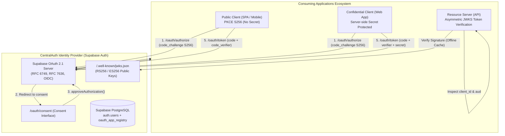
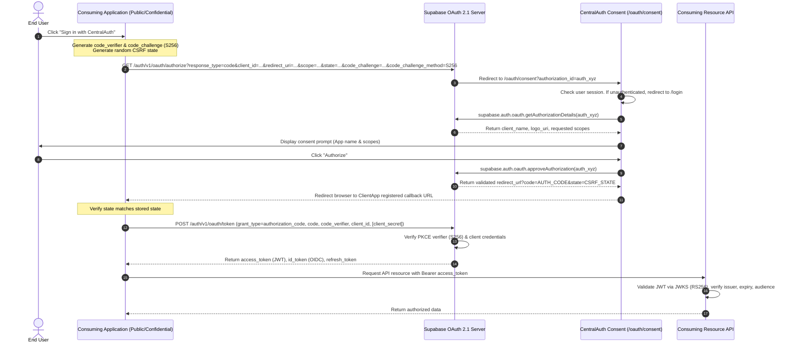

# CentralAuth System Architecture & Trust Boundaries

## 1. Executive Architecture Overview

**CentralAuth** is a centralized, reusable Identity and Access Management (IAM) platform built upon Supabase Auth's OAuth 2.1 and OpenID Connect authorization server capabilities.

CentralAuth serves as the single source of truth for user authentication and authorization across multiple independent web, mobile, and backend microservices.



---

## 2. Core Architectural Principles

### 1. Centralized Identity, Decentralized Resource Ownership
- **Single Identity Store**: All users exist within the central Supabase `auth.users` directory. Passwords, MFA factors, social identity logins, and recovery keys are never duplicated.
- **Independent Resource Authorization**: An OAuth token proves *who the user is* and *which client they authorized*. It does **not** grant unilateral database privileges. Each consuming application independently maps user IDs (`sub`) and client IDs (`aud`) to its own internal tenant, role, and permission models.

### 2. Zero-Trust Client Isolation
- Consuming applications are registered as separate OAuth clients with unique `client_id`s.
- Tokens issued for **Client A** carry `aud: "client-a-id"` or `client_id: "client-a-id"`. If presented to **Client B's** backend, Client B's resource server must immediately reject the token with an HTTP 403 Forbidden.

### 3. Asymmetric Cryptographic Signing (RS256 / ES256)
- Tokens issued by the CentralAuth Authorization Server are signed using asymmetric private keys maintained exclusively by the authorization server.
- Consuming resource servers retrieve the public key set via `https://<project-ref>.supabase.co/auth/v1/.well-known/jwks.json`.
- Consuming applications **never** receive the Supabase `SUPABASE_SERVICE_ROLE_KEY` or private signing keys.

---

## 3. Trust Boundaries & Network Zones

| Zone | Component | Privilege Level | Exposed Secrets |
| :--- | :--- | :--- | :--- |
| **Zone 1: Public Browser / Device** | SPA, Mobile App, End User | Untrusted | Only `client_id`, `code_challenge`, and Public Anon Key. **Zero Client Secrets**. |
| **Zone 2: CentralAuth Frontend** | `/oauth/consent`, `/login`, `/register` | User Interactive Session | Uses `@supabase/ssr` with HttpOnly, SameSite cookies. |
| **Zone 3: CentralAuth Server Runtime** | API Route Handlers (`/api/admin/*`) | Privileged Server-Side | `SUPABASE_SERVICE_ROLE_KEY` (restricted strictly to server runtime). |
| **Zone 4: Consuming Server App** | Node.js / Python / Go Backend | Confidential Client | `client_id`, `client_secret` (stored in AWS Secrets Manager / Vault / secure `.env`). |
| **Zone 5: Supabase Auth Core** | GoTrue OAuth 2.1 Engine | Root Identity Authority | Private asymmetric JWT signing keys, password bcrypt hashes, MFA seeds. |

---

## 4. Complete OAuth 2.1 Authorization Code Flow with PKCE



---

## 5. Token Structure & Custom Claims Hook

When an OAuth client exchanges an authorization code, Supabase Auth emits a standard JWT. With the CentralAuth Custom Access Token Hook enabled in PostgreSQL:

```json
{
  "iss": "https://<project-ref>.supabase.co/auth/v1",
  "sub": "b2c6e210-951b-410a-85b4-d54dca87e382",
  "aud": "customer-portal-spa-dev",
  "exp": 1776510000,
  "nbf": 1776506400,
  "iat": 1776506400,
  "email": "alex.morgan@company.com",
  "app_metadata": {
    "provider": "email",
    "client_id": "customer-portal-spa-dev",
    "roles": ["customer_admin"],
    "permissions": ["orders:read", "orders:create", "invoices:download"]
  },
  "user_metadata": {
    "full_name": "Alex Morgan"
  },
  "scope": "openid email profile"
}
```

This guarantees client-isolated RBAC without allowing clients to falsify their own roles.
