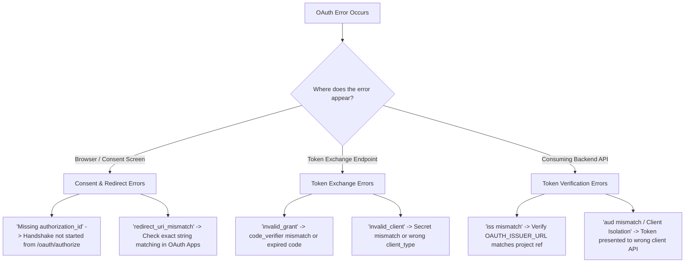

# CentralAuth Troubleshooting Guide

This guide provides diagnostic steps and fixes for common OAuth 2.1, OpenID Connect, and Supabase Auth errors.

---

## 1. Quick Diagnostic Flowchart

---

## 2. Common Errors and Solutions

### 1. `redirect_uri_mismatch`
- **Symptom**: User sees an error before reaching the consent screen, or Supabase returns `error=redirect_uri_mismatch`.
- **Root Cause**: The `redirect_uri` parameter passed to `/oauth/authorize` does not match the exact string registered in Supabase (**Authentication > OAuth Apps**).
- **Fix**:
  1. Check trailing slashes (`/callback` vs `/callback/`).
  2. Check scheme (`http://` vs `https://`).
  3. Check port numbers (e.g., `localhost:3000` vs `localhost:3001`).
  4. Ensure no URL fragments (`#`) or wildcards are present.

---

### 2. `invalid_grant: code_verifier does not match`
- **Symptom**: The token exchange request to `/auth/v1/oauth/token` returns HTTP 400 with `invalid_grant`.
- **Root Cause**:
  1. The `code_verifier` provided during token exchange does not match the SHA-256 hash sent as `code_challenge` in `/oauth/authorize`.
  2. The code verifier was not base64url encoded properly.
  3. The authorization code has expired (codes expire after 10 minutes) or has already been used once.
- **Fix**:
  - Verify your PKCE implementation uses URL-safe Base64 (`-` instead of `+`, `_` instead of `/`, no `=` padding).
  - Authorization codes are strictly single-use. Ensure React `useEffect` double-invocations in StrictMode do not attempt to exchange the code twice.

---

### 3. `invalid_client`
- **Symptom**: `/auth/v1/oauth/token` returns HTTP 401 `invalid_client`.
- **Root Cause**:
  1. The `client_id` is misspelled or deactivated.
  2. The client is registered as a **Confidential Client**, but no `client_secret` was passed in the request header or body.
  3. A **Public Client** attempted to pass a `client_secret` (prohibited in OAuth 2.1).
- **Fix**:
  - For SPAs/Mobile, verify the client is registered as **Public**.
  - For server-side apps, ensure `Basic base64(client_id:client_secret)` is sent in the `Authorization` header.

---

### 4. `JWT verification failed: unexpected "iss" claim value`
- **Symptom**: Consuming API rejects incoming tokens.
- **Root Cause**: The resource server is expecting an issuer string that differs from the one Supabase embeds in the JWT.
- **Fix**:
  - The standard Supabase Auth issuer is: `https://<project-ref>.supabase.co/auth/v1` (or your custom auth domain `https://auth.company.com/auth/v1`).
  - Check `curl https://<project-ref>.supabase.co/auth/v1/.well-known/openid-configuration | jq .issuer` and configure that exact string.

---

### 5. `Client isolation violation` / `unexpected "aud" claim value`
- **Symptom**: Consuming API returns HTTP 403 Forbidden.
- **Root Cause**: A valid user token was issued for **Client A**, but the user or application attempted to send it to **Client B's** backend.
- **Fix**:
  - This is an intentional security safeguard. Verify that the consuming frontend is sending authentication requests to the OAuth authorization server using its own assigned `client_id`.

---

### 6. Consent Screen Shows "Missing authorization_id parameter"
- **Symptom**: Direct navigation to `https://auth.company.com/oauth/consent` shows an error.
- **Root Cause**: The `/oauth/consent` route requires an active `authorization_id` generated by Supabase when initiating an OAuth flow.
- **Fix**:
  - Do not link users directly to `/oauth/consent`.
  - Always initiate the flow via the standard authorization endpoint:
    `https://<project-ref>.supabase.co/auth/v1/oauth/authorize?...`
  - Supabase will generate the `authorization_id` and redirect the user to `/oauth/consent?authorization_id=...`.
